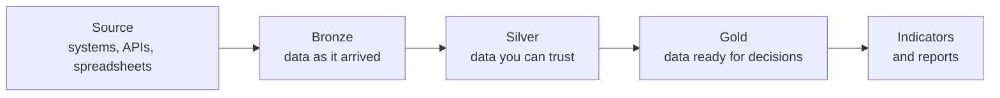
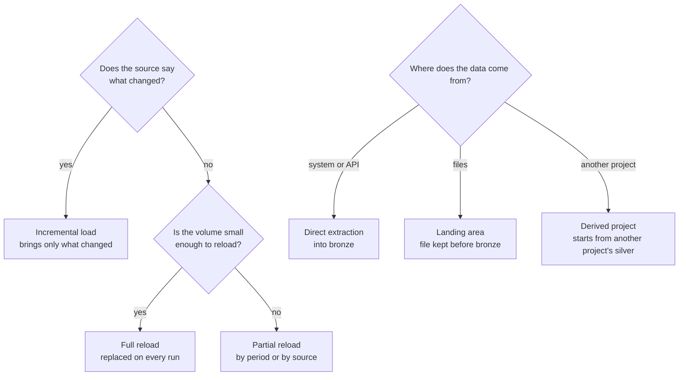

**Goal:** organize the path data takes, from source to indicators, into steps with a clear role. That way every number has a known origin, follows the same quality rules and can be recalculated.

## What the medallion architecture is

It organizes data in **three maturity layers**. Each layer takes data from the previous one and hands a more reliable version to the next. The name comes from medals: bronze, silver and gold, from the rawest data to the most refined.

## The three layers

| Layer | Role | What happens | Who uses it |
|---|---|---|---|
| **Bronze** | Keep the original | Exact copy of the source, with its arrival date. Nothing is corrected or discarded. | Engineering |
| **Silver** | Make data reliable | Correct types, standardized names, duplicates removed, personal data protected. | Engineering and analysis |
| **Gold** | Answer the business | Subject-area tables and indicators, with business rules applied. | Dashboards and management |

## Why separate into layers

- **Nothing is lost.** Because bronze keeps the original, a corrected rule is reapplied from it without querying the source again.
- **Every problem has an address.** An odd number on a dashboard is investigated layer by layer: gold, silver, bronze.
- **One rule, one place.** Silver cleans and standardizes; gold applies business rules. It is clear where each decision was made.
- **One indicator, one number.** Every dashboard reads from gold, so the same indicator shows the same value in any report.
- **Access by layer.** Raw data, which may contain sensitive information, is restricted to engineering; consumption happens in the curated layers.

## One pattern, many flows

The three layers are always the same, but **the path between them depends on the nature of the project**. Before building a flow, a few questions shape the design:

| Nature of the project | Chosen flow | Decision it requires |
|---|---|---|
| Source with a reliable update timestamp | **Incremental**: each run brings only what changed since the last one | Track how far loading has gone and repeat a small safety window; writes must accept repeated records without duplicating them |
| Small table or no change tracking | **Full reload**: the layer is replaced entirely | Simple and always consistent, but history lives in bronze, not silver |
| Same information from several sources | **Multi-source**: each source updates only its own part of the table | Tag each record with its source and standardize everything in silver |
| Data arrives as files (spreadsheets, CSV, fixed layouts) | **Landing area**: the file is stored as received before becoming a bronze table | Record which files were processed so nothing is loaded twice |
| Project that combines already curated data | **Derived**: starts from other projects' silver and produces only its own gold | Do not repeat cleansing another project already does; depend on a stable silver |
| Project that only delivers data to a system or dashboard | **Consumption only**: reads silver or gold and publishes where users need it | Create no layers of its own; data ownership stays with whoever produces it |

Other decisions also depend on the project:

- **How much history to keep in bronze:** everything, when the past must be audited or recalculated; only recent versions, when volume is heavy and the source keeps its own history.
- **Where to protect personal data:** in silver, before any consumption, so gold is born without direct identifiers.
- **Whether gold stays in the lake or is copied:** when dashboards need fast responses, gold is also published to a serving database.

## How I applied it

In an environment with very different sources (databases, APIs and spreadsheets), each handled its own way, I made the medallion architecture the standard for every flow:

1. Every source now enters through **bronze**, with the same loading pattern.
2. Cleansing and standardization rules were concentrated in **silver**, including personal data protection (LGPD, Brazil's GDPR).
3. Indicators are built only in **gold**, and dashboards read only from it.

## Results

- Different sources now follow **the same flow and the same rules**.
- **Every indicator is traceable** back to the original data.
- Fixes are **reapplied from bronze**, with no new extraction.
- Dashboards no longer show different numbers for the same indicator.

The same architecture appears in the [on-premises lakehouse](/en/projects/lakehouse-on-premises/) and [Airflow platform](/en/projects/plataforma-airflow/) case studies.
