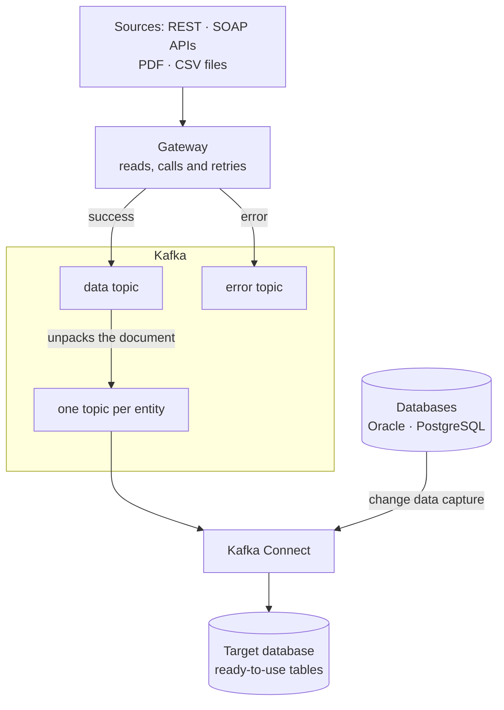

**Goal:** let sources with different protocols and formats (APIs, databases and files such as PDF and CSV) exchange data through a central hub, without a dedicated integration for every pair of systems. A new source should be added with minimal code.

## Starting point

Data arrived through different paths: APIs, databases and files (PDF, CSV and other formats). Each integration was built end to end, from reading the source to writing to the database. When a source failed, data was lost or had to be reprocessed by hand. Responses came as nested documents that were hard to use for analysis.

## What was delivered

1. **A secure, easy-to-operate Kafka environment:** authenticated access, encrypted traffic and scripts to start, check and stop everything with one command.
2. **Integration gateway:** calls APIs and reads files (PDF, CSV and other formats), retries when a failure is temporary and publishes the result to Kafka.
3. **Success and error kept apart:** failed responses go to their own topic with their full content, so they can be reprocessed without calling the source again.
4. **Document unpacking:** each nested document becomes flat records, one topic per entity (header, items, payments).
5. **Writes and capture by configuration:** Kafka Connect writes each topic to a table and captures changes from Oracle and PostgreSQL databases (Debezium).

## Results

- **A new source is added with 1 handler and 1 route**, without touching the rest of the flow.
- **No response is lost:** errors are stored too, with the reason and the number of attempts.
- **No database write code:** target tables are created and updated by Kafka Connect.

## How it works

APIs and files go through the gateway, into Kafka, and are split into entities. Databases come in directly through Kafka Connect, which captures their changes. Finally, Kafka Connect writes each entity to its own table.

## Decisions

- **Errors are data too.** Keeping the full error response makes it possible to reprocess and to understand what the source returned.
- **Retry only when it makes sense.** Temporary failures (slowness, too many requests, server errors) are retried with growing waits; request errors are not.
- **Order preserved per document.** All entities from the same document travel together, in the order they arrived.

**Stack:** Apache Kafka, Kafka Connect, Debezium, Python, PostgreSQL, Docker.
