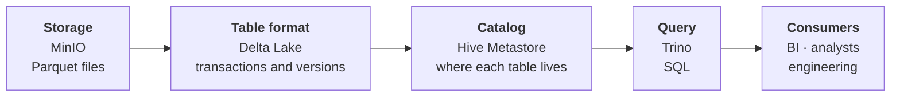
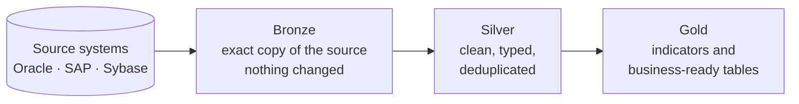

**Goal:** bring data from several institutional systems together in a lakehouse, without a public cloud, to produce management indicators. The project was also a way to master the lakehouse architecture hands-on: how storage, table format, catalog and query engine fit together, and how data matures through the medallion layers.

## Lakehouse: the Databricks model, with open source parts

A lakehouse combines the **low-cost storage of a data lake** with the **guarantees of a data warehouse** (transactions, schema, history). It was popularized by Databricks, the creator of **Delta Lake**, the table format that makes it possible.

Here the same architecture was built on in-house servers, piece by piece:

| Role in the architecture | On Databricks | In this project |
|---|---|---|
| Object storage | S3 / ADLS | **MinIO** (S3-compatible) |
| Table format | Delta Lake | **Delta Lake** |
| Table catalog | Unity Catalog | **Hive Metastore** |
| SQL query | Databricks SQL | **Trino** |
| Access control | Unity Catalog permissions | **Profile-based rules in Trino** + MinIO policies |
| Data organization | Medallion architecture | **Bronze, silver and gold** |

## How the lakehouse works

Each layer has one job: **MinIO** stores the files, **Delta Lake** turns those files into reliable tables, **Hive Metastore** knows where each table lives and **Trino** makes everything queryable with SQL.

## Medallion architecture

- **Bronze** keeps data as it came from the source. If a rule changes, data can be reprocessed without hitting the source system again.
- **Silver** is curated data: correct types, standardized and deduplicated.
- **Gold** holds the tables ready for indicators and reports.

Analysts and BI access only silver and gold. Bronze is restricted to engineering.

## What was delivered

1. **A complete lakehouse** with MinIO, Delta Lake, Hive Metastore and Trino.
2. **Medallion layers** in separate buckets, each with its own access rules.
3. **Profile-based access control:** engineering sees all three layers; analysts see only silver and gold.
4. **Data protection:** encrypted traffic, each service with only the permissions it needs, and credentials kept out of code.
5. **Support tools:** row count reconciliation between source and lake, and a report of reclaimable storage.

## Results

- Data from many systems **queryable with SQL in one place**.
- **3 access profiles:** analysts cannot see raw data.
- **Least-privilege storage policies:** read-only users cannot write, and each loading account only reaches the buckets it needs.

## Decisions

- **Open format.** With Delta Lake, tables can be read by other tools (Spark, Trino, DuckDB, Databricks) without conversion.
- **Lakehouse separate from pipelines.** The infrastructure knows no business rules; loading lives in the pipelines, orchestrated by the [Airflow platform](/en/projects/plataforma-airflow/).
- **Access controlled at two points:** Trino decides what each person sees; MinIO decides what each service can do.
- **Processing engine by volume.** Loads up to ~20 GB run on a single node, with no cluster; larger recurring loads go to Spark.

**Stack:** Delta Lake, MinIO, Trino, Hive Metastore, Spark, PostgreSQL, Docker.
