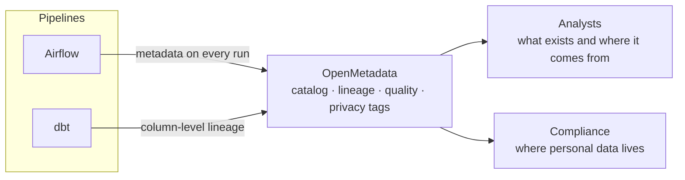

**Goal:** quickly answer two common questions in environments with sensitive data: *where did this number come from?* and *where is the personal data?*

## Starting point

Without a catalog or lineage, tracing an indicator back to its source or locating personal data depended on the knowledge of whoever built each pipeline.

## What was delivered

1. **A data catalog** with the lake and serving database tables, each with an owner and a description.
2. **Column-level lineage** from the dbt models: from each indicator back to the source table.
3. **Classification of personal data** (LGPD, Brazil's GDPR) by tagging sensitive columns.
4. **Quality tests** registered alongside each table.

## Results

- An indicator's origin is looked up in the catalog, with no need to read code.
- Columns with personal data are identified and have a defined owner.
- The catalog updates on every pipeline run, with no manual effort.

## How it works

The pipelines themselves feed the catalog. Data consumers find there the origin, quality and sensitivity of each table.

## Decisions

- **Governance inside the pipeline**, not as a manual step at the end.
- **Lineage generated from dbt** instead of documented by hand.
- **Sensitivity tagged at the column**, which is where access rules need to act.

It can be applied to the pipelines in the [on-premises lakehouse](/en/projects/lakehouse-on-premises/) and [Kafka integration](/en/projects/integracao-kafka/) case studies.

**Stack:** OpenMetadata, dbt, Airflow, PostgreSQL, MinIO.
