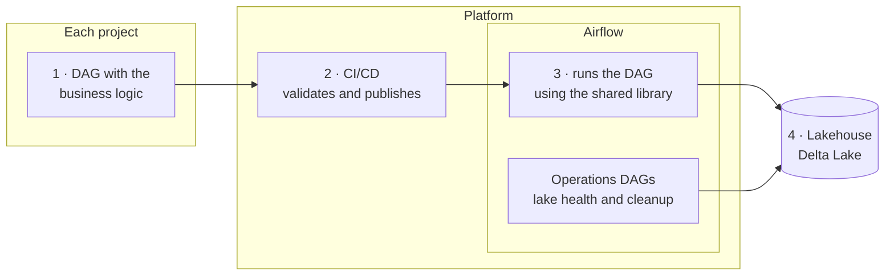

**Goal:** a single orchestration environment for every data project, where each pipeline only deals with its own business logic. Everything else (alerting, incremental loading, writing to Delta Lake, keeping the lake healthy and publishing DAGs) is the platform's job.

## Starting point

Every project had its own copy of the same utilities: alert emails, data cleansing, incremental load control, Delta Lake writes. Fixing a bug meant fixing it in every repository. Lake maintenance was left to each DAG, and each one did it differently.

## What was delivered

1. **A shared library** that every DAG imports: email alerts, cleansing and standardization, anonymization of personal data, incremental load control and Delta Lake writes.
2. **Operations DAGs** that look after the lake on their own: daily health checks on tables and storage, cleanup of old versions, compaction of small files and an end-of-day failure report.
3. **A CI/CD template** each project includes with a few lines: it validates the DAGs and publishes them to Airflow on every merge.

## Results

- **Less rework.** Several data projects use the same library, and none keeps its own copy of the utilities.
- **Fix it once.** A change in the library reaches every pipeline, and contract tests keep it from breaking existing users.
- **A healthy lake with no manual work.** Operations DAGs handle Delta Lake maintenance and warn before a problem becomes an incident (abnormal growth, too many small files, stray data outside tables).
- **New projects onboard fast.** They only need to include the CI template and import the library.

## How it works

1. The project writes only the DAG with its own logic.
2. CI/CD validates the DAG and publishes it to Airflow.
3. Airflow runs the DAG, which uses the shared library for alerts, incremental loads and Delta Lake writes.
4. Data lands in the lakehouse, which the operations DAGs keep in order.

## Decisions

- **What is shared lives in the platform; what is business logic lives in the project.** If only one project uses it, it does not go into the library.
- **One library version for everyone.** No project gets stuck on an old copy; tests make sure an update does not break anyone.
- **Maintenance separate from loading.** Cleanup and compaction run in their own DAGs, with the same rules for every table.

**Stack:** Airflow 3, Python, Delta Lake, PostgreSQL, GitLab CI, pytest.
