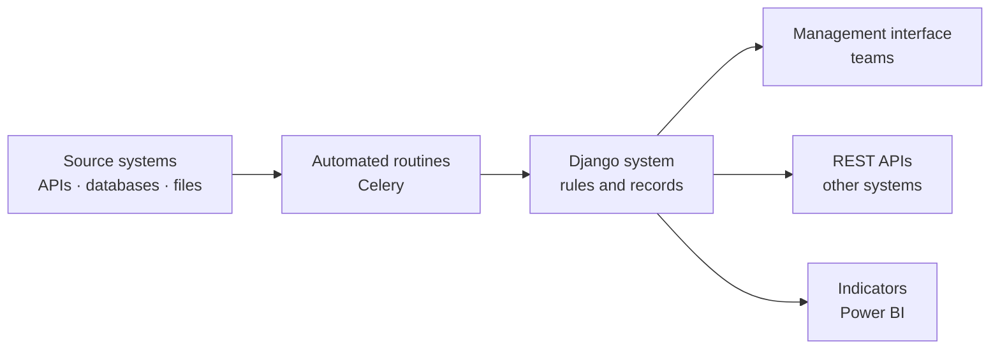

**Goal:** replace spreadsheets, manual file exchanges and scattered processes with web systems that integrate data sources and give teams an interface to look up, register and track what they need.

## Starting point

Important information was spread across systems that did not talk to each other. Feeding one system with data from another depended on manual exports and imports, and teams had no single place to follow the progress of their processes.

## What was delivered

1. **System integration through APIs:** Django consumes the sources' APIs and exposes its own REST APIs to the systems that need the data.
2. **Automated routines:** scheduled loads, syncs and lookups run in the background (Celery), with no manual work.
3. **Management interface:** screens for teams to register, look up and track records and processes, with per-user access control.
4. **Analysis-ready data:** the information organized by the system feeds indicators in Power BI.

## Results

- Systems that depended on manual exchange now **share data automatically**.
- Repetitive loading and checking tasks became **scheduled routines**.
- Teams gained **a single place** to follow their data and processes.

## How it works

The routines bring data from the sources, Django applies the rules and keeps everything in one place, and the information reaches teams through the interface, other systems through the APIs and management through the indicators.

## Decisions

- **Django for productivity:** built-in admin, authentication and ORM make it fast to deliver and keep the focus on business rules.
- **Heavy work outside the request:** loads and integrations run in the background, so the interface stays fast.
- **Everything in containers:** the same environment runs on the development machine and on the server.

**Stack:** Django, Python, REST APIs, Celery, PostgreSQL, SQLite, Docker, Power BI.
