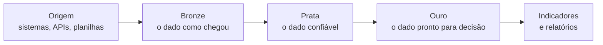
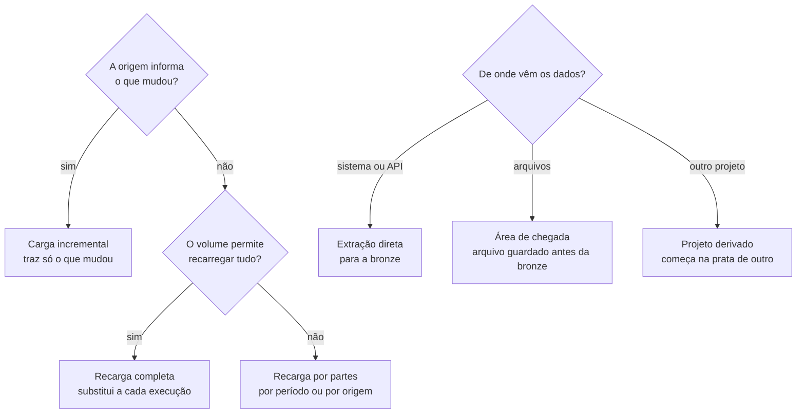

**Objetivo:** organizar o caminho dos dados, da origem até os indicadores, em etapas com papel bem definido. Assim, todo número tem origem conhecida, segue as mesmas regras de qualidade e pode ser recalculado.

## O que é a arquitetura medalhão

É uma forma de organizar os dados em **três camadas de maturidade**. Cada camada recebe o dado da anterior e entrega uma versão mais confiável para a próxima. O nome vem das medalhas: bronze, prata e ouro, do dado mais bruto ao mais refinado.

## As três camadas

| Camada | Papel | O que acontece | Quem usa |
|---|---|---|---|
| **Bronze** | Guardar o original | Cópia fiel da origem, com a data de chegada. Nada é corrigido nem descartado. | Engenharia |
| **Prata** | Tornar o dado confiável | Tipos corretos, nomes padronizados, duplicidades removidas, dados pessoais protegidos. | Engenharia e análises |
| **Ouro** | Responder ao negócio | Tabelas por assunto e indicadores, com as regras de negócio aplicadas. | Painéis e gestão |

## Por que separar em camadas

- **Nada se perde.** Como a bronze guarda o original, uma regra corrigida é reaplicada a partir dela, sem consultar a origem de novo.
- **Cada problema tem endereço.** Um número estranho no painel é investigado camada por camada: ouro, prata, bronze.
- **Uma regra, um lugar.** A prata limpa e padroniza; a ouro aplica a regra de negócio. Fica claro onde cada decisão foi tomada.
- **Um indicador, um número.** Todos os painéis leem da camada ouro, então o mesmo indicador mostra o mesmo valor em qualquer relatório.
- **Acesso por camada.** O dado bruto, que pode conter informação sensível, fica restrito à engenharia; o consumo acontece nas camadas tratadas.

## Um padrão, vários fluxos

As três camadas são sempre as mesmas, mas **o caminho entre elas muda conforme a natureza do projeto**. Antes de construir o fluxo, algumas perguntas definem o desenho:

| Natureza do projeto | Fluxo escolhido | Decisão que isso exige |
|---|---|---|
| Origem com data de atualização confiável | **Incremental**: cada execução traz só o que mudou desde a anterior | Guardar até onde já foi carregado e repetir uma pequena janela de segurança; a gravação precisa aceitar registros repetidos sem duplicar |
| Tabela pequena ou sem controle de mudança | **Recarga completa**: a camada é substituída inteira | Simples e sempre consistente, mas o histórico fica na bronze, não na prata |
| Mesma informação vinda de várias origens | **Multi-origem**: cada origem atualiza só a sua parte da tabela | Identificar a origem em cada registro e padronizar tudo na prata |
| Dados chegam em arquivos (planilhas, CSV, layouts fixos) | **Área de chegada**: o arquivo é guardado como veio antes de virar tabela na bronze | Registrar quais arquivos já foram processados, para não carregar duas vezes |
| Projeto que cruza dados já tratados | **Derivado**: começa na prata de outros projetos e só produz a sua ouro | Não repetir limpeza que outro projeto já fez; depender de uma prata estável |
| Projeto que só entrega dados para um sistema ou painel | **Só consumo**: lê a prata ou a ouro e publica onde o usuário precisa | Não criar camadas próprias; a responsabilidade pelo dado continua em quem o produz |

Outras decisões também dependem do projeto:

- **Quanto histórico guardar na bronze:** tudo, quando é preciso auditar ou recalcular o passado; só as versões recentes, quando o volume pesa e a origem mantém o histórico.
- **Onde proteger dados pessoais:** na prata, antes de qualquer consumo, para que a ouro já nasça sem identificação direta.
- **Se a ouro fica no lake ou é copiada:** quando os painéis precisam de resposta rápida, a ouro é publicada também em um banco de consumo.

## Como apliquei

Em um ambiente com fontes muito diferentes (bancos de dados, APIs e planilhas), cada uma tratada de um jeito, adotei a arquitetura medalhão como padrão para todos os fluxos:

1. Toda fonte passou a entrar pela **bronze**, com o mesmo padrão de carga.
2. As regras de limpeza e padronização ficaram concentradas na **prata**, incluindo a proteção de dados pessoais (LGPD).
3. Os indicadores passaram a ser construídos só na **ouro**, e os painéis passaram a ler apenas dela.

## Resultado

- Fontes diferentes passaram a seguir **o mesmo fluxo e as mesmas regras**.
- **Todo indicador ficou rastreável** até o dado original.
- Correções passaram a ser **reaplicadas a partir da bronze**, sem nova extração.
- Os painéis deixaram de mostrar números diferentes para o mesmo indicador.

A mesma arquitetura aparece nos cases de [lakehouse on-premises](/projetos/lakehouse-on-premises/) e da [plataforma Airflow](/projetos/plataforma-airflow/).
