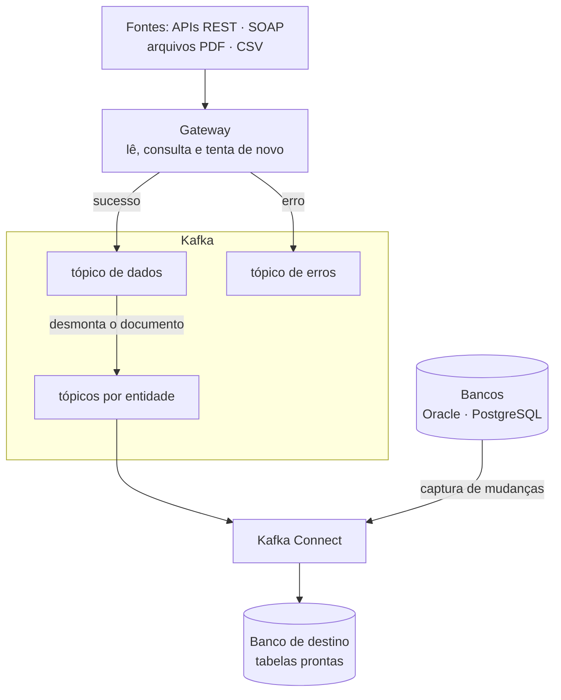

**Objetivo:** permitir que fontes com protocolos e formatos diferentes (APIs, bancos de dados e arquivos como PDF e CSV) troquem dados por um ponto central, sem uma integração dedicada para cada par de sistemas. Uma nova fonte deve entrar com o mínimo de código.

## O ponto de partida

Os dados chegavam por caminhos diferentes: APIs, bancos de dados e arquivos (PDF, CSV e outros formatos). Cada integração era construída de ponta a ponta, da leitura da fonte até a gravação no banco. Quando a fonte falhava, o dado se perdia ou exigia reprocessamento manual. As respostas vinham como documentos aninhados, difíceis de usar em análise.

## O que foi entregue

1. **Ambiente Kafka seguro e fácil de operar:** acesso autenticado, tráfego cifrado e scripts para subir, verificar e parar tudo com um comando.
2. **Gateway de integração:** consulta APIs e lê arquivos (PDF, CSV e outros formatos), tenta de novo quando a falha é temporária e publica o resultado no Kafka.
3. **Separação entre sucesso e erro:** respostas com erro vão para um tópico próprio, com todo o conteúdo, para reprocessar sem consultar a fonte de novo.
4. **Desmontagem de documentos:** cada documento aninhado vira registros planos, um tópico por entidade (cabeçalho, itens, pagamentos).
5. **Gravação e captura por configuração:** o Kafka Connect grava cada tópico em uma tabela e captura mudanças de bancos Oracle e PostgreSQL (Debezium).

## Resultado

- **Uma fonte nova entra com 1 handler e 1 rota**, sem mexer no restante do fluxo.
- **Nenhuma resposta perdida:** o que dá erro também é guardado, com o motivo e o número de tentativas.
- **Nenhum código de gravação no banco:** as tabelas de destino são criadas e atualizadas pelo Kafka Connect.

## Como funciona

APIs e arquivos passam pelo gateway, vão para o Kafka e são quebrados em entidades. Os bancos entram direto pelo Kafka Connect, que captura as mudanças. No fim, o Kafka Connect grava cada entidade na sua tabela.

## Decisões

- **Erro também é dado.** Guardar a resposta de erro completa permite reprocessar e entender o que a fonte devolveu.
- **Tentar de novo só quando faz sentido.** Falhas temporárias (lentidão, excesso de requisições, erro do servidor) são repetidas com espera crescente; erros de requisição, não.
- **Ordem preservada por documento.** Todas as entidades de um mesmo documento seguem juntas, na ordem em que chegaram.

**Stack:** Apache Kafka, Kafka Connect, Debezium, Python, PostgreSQL, Docker.
