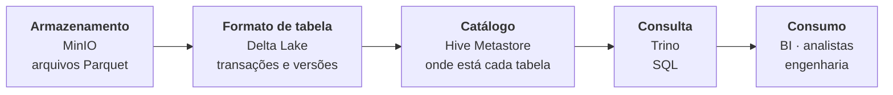
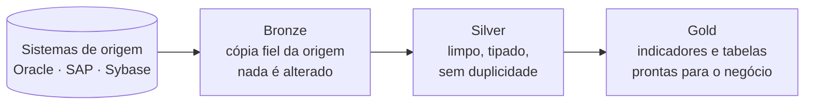

**Objetivo:** reunir as bases de vários sistemas institucionais em um lakehouse, sem nuvem pública, para gerar indicadores de gestão. O projeto também foi uma forma de dominar na prática a arquitetura lakehouse: como storage, formato de tabela, catálogo e motor de consulta se encaixam, e como os dados evoluem nas camadas medalhão.

## Lakehouse: o modelo da Databricks, com peças open source

Lakehouse é a arquitetura que junta o **armazenamento barato de um data lake** com as **garantias de um data warehouse** (transações, schema, histórico). Foi popularizada pela Databricks, criadora do **Delta Lake**, o formato de tabela que torna isso possível.

Aqui, a mesma arquitetura foi montada em servidores próprios, peça por peça:

| Papel na arquitetura | Na Databricks | Neste projeto |
|---|---|---|
| Armazenamento de objetos | S3 / ADLS | **MinIO** (compatível com S3) |
| Formato de tabela | Delta Lake | **Delta Lake** |
| Catálogo de tabelas | Unity Catalog | **Hive Metastore** |
| Consulta SQL | Databricks SQL | **Trino** |
| Controle de acesso | Permissões do Unity Catalog | **Regras por perfil no Trino** + políticas no MinIO |
| Organização dos dados | Arquitetura medalhão | **Bronze, silver e gold** |

## Como o lakehouse funciona

Cada camada tem uma função: o **MinIO** guarda os arquivos, o **Delta Lake** transforma esses arquivos em tabelas confiáveis, o **Hive Metastore** diz onde cada tabela está e o **Trino** permite consultar tudo com SQL.

## Arquitetura medalhão

- **Bronze** guarda o dado como veio da origem. Se uma regra mudar, dá para reprocessar sem consultar o sistema de novo.
- **Silver** é o dado tratado: tipos corretos, padronização e sem duplicidade.
- **Gold** tem as tabelas prontas para indicadores e relatórios.

Analistas e BI acessam apenas silver e gold. O bronze fica restrito à engenharia.

## O que foi entregue

1. **Lakehouse completo** com MinIO, Delta Lake, Hive Metastore e Trino.
2. **Camadas medalhão** em buckets separados, com regras de acesso diferentes para cada uma.
3. **Controle de acesso por perfil:** engenharia vê as três camadas; analistas veem só silver e gold.
4. **Proteção dos dados:** tráfego cifrado, cada serviço só com a permissão de que precisa e credenciais fora do código.
5. **Ferramentas de apoio:** conferência de contagens entre origem e lake e relatório de espaço que pode ser liberado.

## Resultado

- Bases de vários sistemas **consultáveis por SQL em um único lugar**.
- **3 perfis de acesso:** o analista não vê o dado bruto.
- **Políticas de storage de menor privilégio:** quem só consulta não consegue gravar, e cada conta de carga só alcança os buckets de que precisa.

## Decisões

- **Formato aberto.** Com Delta Lake, as tabelas podem ser lidas por outras ferramentas (Spark, Trino, DuckDB, Databricks) sem conversão.
- **Lakehouse separado dos pipelines.** A infraestrutura não conhece regra de negócio; a carga fica nos pipelines, orquestrados pela [plataforma Airflow](/projetos/plataforma-airflow/).
- **Acesso controlado em dois pontos:** no Trino, o que cada pessoa vê; no MinIO, o que cada serviço pode fazer.
- **Motor de processamento por volume.** Cargas de até ~20 GB rodam em nó único, sem cluster; acima disso e recorrentes, entram no Spark.

**Stack:** Delta Lake, MinIO, Trino, Hive Metastore, Spark, PostgreSQL, Docker.
