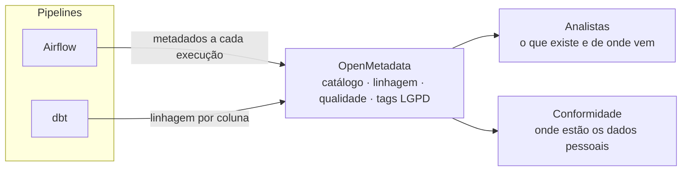

**Objetivo:** responder rapidamente a duas perguntas comuns em ambientes com dado sensível: *de onde veio este número?* e *onde estão os dados pessoais?*

## O ponto de partida

Sem catálogo e sem linhagem, rastrear a origem de um indicador ou localizar dados pessoais dependia de conhecimento de quem construiu cada pipeline.

## O que foi entregue

1. **Catálogo de dados** com as tabelas do lake e dos bancos de consumo, com responsável e descrição.
2. **Linhagem por coluna** a partir dos modelos dbt: de cada indicador até a tabela de origem.
3. **Classificação de dados pessoais** (LGPD) por marcação nas colunas sensíveis.
4. **Testes de qualidade** registrados junto de cada tabela.

## Resultado

- A origem de um indicador é consultada no catálogo, sem precisar ler código.
- Colunas com dados pessoais ficam identificadas e com responsável definido.
- O catálogo se atualiza a cada execução dos pipelines, sem esforço manual.

## Como funciona

Os próprios pipelines alimentam o catálogo. Quem consome o dado encontra ali a origem, a qualidade e a sensibilidade de cada tabela.

## Decisões

- **Governança dentro do pipeline**, não como etapa manual no final.
- **Linhagem gerada a partir do dbt**, em vez de documentada à mão.
- **Sensibilidade marcada na coluna**, que é onde as regras de acesso precisam atuar.

Pode ser aplicado aos pipelines dos cases de [lakehouse on-premises](/projetos/lakehouse-on-premises/) e de [integração com Kafka](/projetos/integracao-kafka/).

**Stack:** OpenMetadata, dbt, Airflow, PostgreSQL, MinIO.
