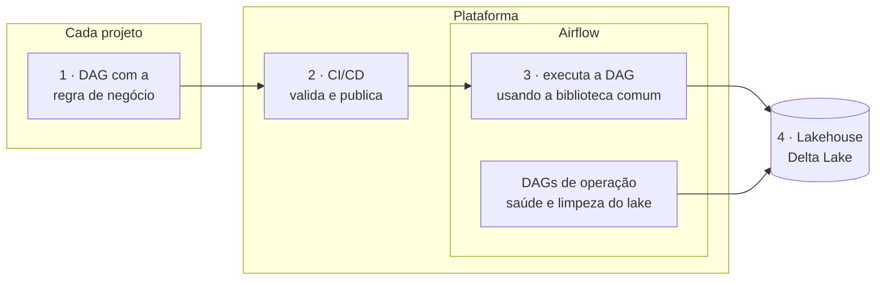

**Objetivo:** ter um ambiente de orquestração único para todos os projetos de dados, em que cada pipeline se preocupa apenas com a própria regra de negócio. O restante (alertar, carregar de forma incremental, gravar no Delta Lake, manter o lake saudável e publicar as DAGs) é responsabilidade da plataforma.

## O ponto de partida

Cada projeto tinha a sua própria cópia de utilitários: e-mail de alerta, limpeza de dados, controle de carga incremental, escrita no Delta Lake. Corrigir um problema significava corrigir em todos os repositórios. A manutenção do lake ficava a cargo de cada DAG, e cada uma fazia de um jeito.

## O que foi entregue

1. **Biblioteca compartilhada** que todas as DAGs importam: alertas por e-mail, limpeza e padronização, anonimização de dados pessoais, controle de carga incremental e escrita no Delta Lake.
2. **DAGs de operação** que cuidam do lake sozinhas: verificam diariamente a saúde das tabelas e do storage, limpam versões antigas, compactam arquivos pequenos e enviam um relatório de falhas no fim do dia.
3. **Template de CI/CD** que cada projeto inclui com poucas linhas: valida as DAGs e publica no Airflow a cada merge.

## Resultado

- **Menos retrabalho.** Vários projetos de dados usam a mesma biblioteca, e nenhum mantém cópia própria de utilitário.
- **Correção feita uma vez.** Um ajuste na biblioteca chega a todos os pipelines, e os testes de contrato impedem que ele quebre quem já usa.
- **Lake saudável sem intervenção manual.** DAGs de operação cuidam da manutenção do Delta Lake e avisam antes de o problema virar incidente (crescimento anormal, excesso de arquivos pequenos, dados soltos fora das tabelas).
- **Projeto novo entra rápido.** Basta incluir o template de CI e importar a biblioteca.

## Como funciona

1. O projeto escreve só a DAG com a sua lógica.
2. O CI/CD valida e publica a DAG no Airflow.
3. O Airflow executa a DAG, que usa a biblioteca comum para alertas, carga incremental e escrita no Delta Lake.
4. Os dados chegam ao lakehouse, que as DAGs de operação mantêm em ordem.

## Decisões

- **O que é comum fica na plataforma, o que é de negócio fica no projeto.** Se só um projeto usa, não entra na biblioteca.
- **Uma versão da biblioteca para todos.** Evita que cada projeto fique preso a uma cópia antiga; os testes garantem que uma atualização não quebra ninguém.
- **Manutenção separada da carga.** Limpeza e compactação rodam em DAGs próprias, com a mesma regra para todas as tabelas.

**Stack:** Airflow 3, Python, Delta Lake, PostgreSQL, GitLab CI, pytest.
