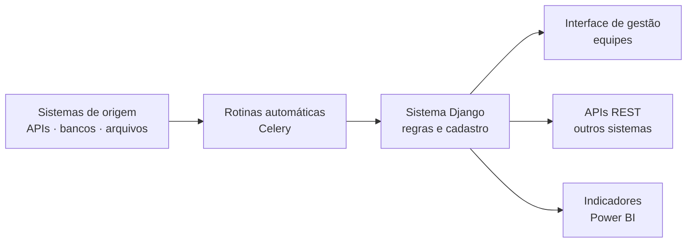

**Objetivo:** substituir planilhas, trocas manuais de arquivos e processos soltos por sistemas web que integram as fontes de dados e dão às equipes uma interface para consultar, cadastrar e acompanhar o que precisam.

## O ponto de partida

Informações importantes ficavam espalhadas entre sistemas que não conversavam entre si. Alimentar um sistema com dados de outro dependia de exportação e importação manual, e as equipes não tinham um lugar único para acompanhar o andamento dos processos.

## O que foi entregue

1. **Integração entre sistemas por API:** o Django consome as APIs das fontes e expõe as próprias APIs REST para os sistemas que precisam dos dados.
2. **Rotinas automáticas:** cargas, sincronizações e consultas agendadas rodam em segundo plano (Celery), sem intervenção manual.
3. **Interface de gestão:** telas para as equipes cadastrarem, consultarem e acompanharem registros e processos, com controle de acesso por usuário.
4. **Dados prontos para análise:** as informações organizadas pelo sistema alimentam indicadores no Power BI.

## Resultado

- Sistemas que antes dependiam de troca manual passaram a **trocar dados automaticamente**.
- Tarefas repetitivas de carga e conferência viraram **rotinas agendadas**.
- As equipes ganharam **um lugar único** para acompanhar os dados e os processos.

## Como funciona

As rotinas trazem os dados das fontes, o Django aplica as regras e guarda tudo em um só lugar, e a informação chega às equipes pela interface, a outros sistemas pelas APIs e à gestão pelos indicadores.

## Decisões

- **Django pela produtividade:** administração, autenticação e ORM prontos permitem entregar rápido e focar na regra de negócio.
- **Processamento pesado fora da requisição:** cargas e integrações rodam em segundo plano, e a interface continua rápida.
- **Tudo em contêiner:** o mesmo ambiente roda na máquina de desenvolvimento e no servidor.

**Stack:** Django, Python, REST APIs, Celery, PostgreSQL, SQLite, Docker, Power BI.
